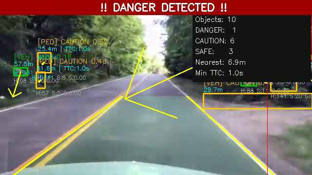
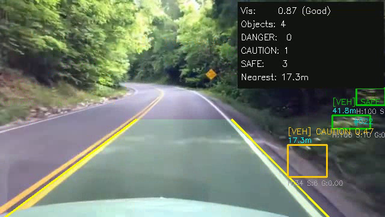
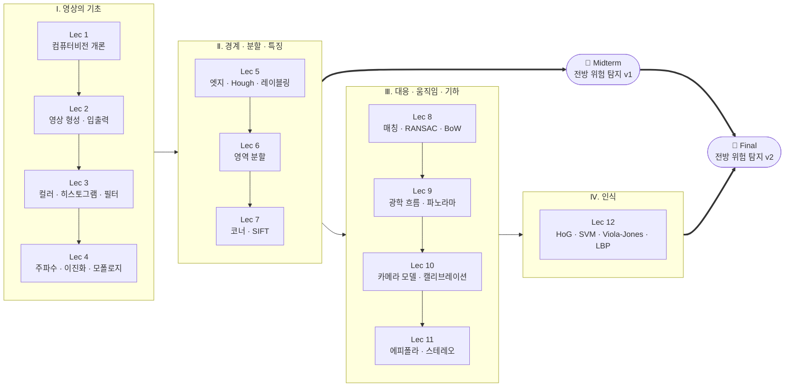
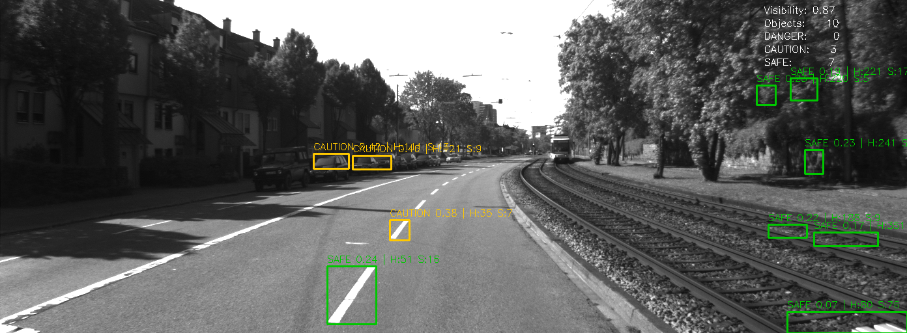
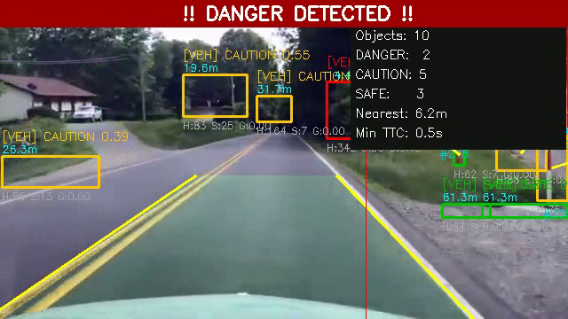
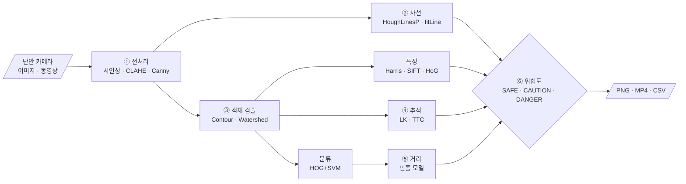

<div align="center">

# 🎥 Industrial Computer Vision

**충북대학교 전자공학부 · 산업 컴퓨터비전 (2026 Spring)**
<br/>
강의자: 황영배 교수님

<br/>


<br/>

> 픽셀 하나에서 출발해 카메라 기하와 객체 인식까지.<br/>
> 12개 강의 자료, 그리고 그 내용을 하나로 엮은 **단안 카메라 전방 위험 탐지 프로젝트**를 담은 저장소입니다.

<br/>




<sub>▲ Final 프로젝트를 공개 대시캠 영상에 적용한 결과: 차선 영역, 객체별 위험 등급·거리(m)·TTC, 우측 상단 HUD</sub>

<br/><br/>

[📚 강의 커리큘럼](#-강의-커리큘럼) ·
[📖 강의별 상세](#-강의별-상세) ·
[🚗 프로젝트](#-프로젝트-단안-카메라-전방-위험-탐지) ·
[🗂️ 데이터](#️-데이터) ·
[⚙️ 실행 방법](#️-실행-환경과-빠른-시작)

</div>

---

## 📌 한눈에 보기

| 구분 | 내용 |
|:---:|---|
| 📚 **강의 자료** | Lecture 1 ~ 12 PDF, 슬라이드 총 1,055장 (`1/` ~ `12/`) |
| 🚗 **Midterm** | 단안 카메라 전방 위험 객체 탐지 v1. Lec 3~7 기법, Python 모듈 6개 (517줄) |
| 🚀 **Final** | v1을 Phase 1~6으로 고도화한 v2. 차선·분류·추적·TTC·거리 추정 추가, 모듈 11개 (1,475줄) |
| 🗂️ **데이터** | 강의 실습용 이미지·영상, 체스보드 캘리브레이션 세트, 공개 대시캠 주행 영상 |
| 🧰 **도구** | Python 3, OpenCV, NumPy. 딥러닝 없이 고전 영상처리만 사용 |

---

## 📚 강의 커리큘럼

### 과목 정보

| 항목 | 내용 |
|---|---|
| 과목 | 산업 컴퓨터비전 (Industrial Computer Vision), 2026년 봄학기 |
| 강의자 | 황영배 교수님 |
| 교재 | 『파이썬과 OpenCV를 이용한 컴퓨터 비전 학습: OpenCV-Python으로 배우는 영상 처리 및 응용』 |
| 참고서 | Richard Szeliski, *Computer Vision: Algorithms and Applications* ([온라인 PDF](http://szeliski.org/Book/)) |
| 평가 | 출석 20% · 과제 40% · 중간/기말 프로젝트 40% |

### 학습 로드맵



### 주차별 일정

<sub>Lecture 1의 강의계획서 기준입니다. 「교재」 열은 교재의 장 번호입니다.</sub>

| 주차 | 주제 | 교재 | 강의 자료 |
|:---:|---|:---:|:---:|
| 1 | 컴퓨터비전 개론 | — | [Lec 1](1/lecture1.pdf) |
| 2 | 입출력 & GUI | ch.1 | [Lec 2](2/lecture2.pdf) |
| 3 | 히스토그램 & 필터링 | ch.2 | [Lec 3](3/lecture3.pdf) |
| 4 | 주파수 기반 영상처리 | ch.2 | [Lec 4](4/lecture4.pdf) |
| 5 | 경계 추출 | ch.3 | [Lec 5](5/lecture5.pdf) |
| 6 | 영상 분할 | ch.3 | [Lec 6](6/lecture6.pdf) |
| 7 | 코너 검출 | ch.7 | [Lec 7](7/lecture7.pdf) |
| **8** | **🚗 중간 프로젝트** | | [Midterm_exam](Midterm_exam/README.md) |
| 9 ~ 10 | 불변 특징·기술자, 대응점 탐색 | ch.7 · 8 | [Lec 8](8/lecture8.pdf) |
| 11 | 광학 흐름 & 파노라마 | ch.8 | [Lec 9](9/lecture9.pdf) |
| 12 | 카메라 캘리브레이션 | ch.9 | [Lec 10](10/lecture10.pdf) |
| 13 | 스테레오 카메라 | ch.9 | [Lec 11](11/lecture11.pdf) |
| 14 | 객체 검출기 | ch.4 | [Lec 12](12/lecture12.pdf) |
| **15** | **🚀 기말 프로젝트** | | [Final_exam](Final_exam/README.md) |

---

## 📖 강의별 상세

각 강의 PDF의 슬라이드 구성을 정리했습니다. 항목을 누르면 펼쳐집니다.

| Lec | 주제 | 핵심 키워드 | 슬라이드 |
|:---:|---|---|:---:|
| 1 | Introduction of Computer Vision | 비전의 목표, 대응·정렬, 3D 센싱, 파운데이션 모델 | 97 |
| 2 | Image Formation & Digital Image | 샘플링·양자화, 해상도, 보간, OpenCV 입출력 | 49 |
| 3 | Color, Histogram & Filtering | Bayer, 색공간, 감마, 히스토그램 평탄화, Median·Bilateral | 83 |
| 4 | Gradient, Frequency & Morphology | Sobel, Unsharp, DFT, Otsu, 침식·팽창 | 72 |
| 5 | Edge Detection & Boundary | Canny, Hough, Connected Component, Contour | 105 |
| 6 | Image Segmentation | Region Growing, Watershed, K-means, GrabCut | 68 |
| 7 | Corner Detection & SIFT | Harris, FAST, MOPS, DoG, SIFT 기술자 | 74 |
| 8 | Feature Matching & RANSAC | Ratio test, Homography, RANSAC, BoW, ORB | 91 |
| 9 | Optical Flow & Panorama | Lucas-Kanade, 피라미드, Warping, Blending | 115 |
| 10 | Camera Models & Calibration | 핀홀·렌즈, 카메라 행렬, DLT, 왜곡 모델 | 120 |
| 11 | Epipolar Geometry & Stereo | 삼각측량, E·F 행렬, 8-point, Rectification, SGM | 111 |
| 12 | Object Detection | HoG, KNN, SVM, Viola-Jones, LBP | 70 |

<details>
<summary><b>Lec 1 · Introduction of Computer Vision</b> — 컴퓨터비전이란 무엇인가</summary>

<br/>

**이론**
- 컴퓨터비전의 정의와 인접 분야, 사람의 시각과 컴퓨터의 시각 비교
- 영상 형성과 핀홀 카메라 모델: "영상은 3D 세계를 2D 평면에 투영한 것"
- 비전의 핵심 문제: 대응(Correspondence)과 정렬(Alignment), 불변 지역 특징, 키포인트 매칭
- 객체 검출: Sliding Window, 통계적 템플릿, HOG 특징, Part-based 모델
- 3D 센싱: Structured Light, ToF, 스테레오 비전(삼각측량, 정렬, 스테레오 매칭)
- 응용: 자동 외관 검사, 무인 매장, 3D 복원, 이미지 합성, 자율주행
- 최신 동향: Foundation Model(SAM, Depth Anything), Image Captioning, Physical AI, VLA, World Model, Medical AI

**실습:** Python · OpenCV 설치

📄 [lecture1.pdf](1/lecture1.pdf)
</details>

<details>
<summary><b>Lec 2 · Image Formation & Digital Image</b> — 빛에서 픽셀까지</summary>

<br/>

**이론**
- 사람 눈의 영상 형성, 시각 시스템의 밝기 범위, Mach band, 동시 대비, 착시
- 전자기 스펙트럼과 빛, 센서(단일·라인·어레이) 기반 영상 획득
- 영상 형성 모델 `f(x, y) = i(x, y) · r(x, y)` (조명 × 반사)
- 샘플링과 양자화, 디지털 영상 표현과 좌표계, 동적 범위
- 공간 해상도(DPI)와 밝기 해상도
- 영상 보간: Nearest Neighbor, Bilinear, Bicubic

**실습**
- 개발 환경: Anaconda, PyCharm / VS Code, Conda 가상환경
- 파일 읽기, `Mat`과 `numpy.ndarray` 구조, 크기 변경·뒤집기
- 손실/무손실 압축 저장, 창 띄우기, 트랙바, 2D 도형 그리기
- 키보드·마우스 입력 처리, 동영상 프레임 재생

📄 [lecture2.pdf](2/lecture2.pdf)
</details>

<details>
<summary><b>Lec 3 · Color, Histogram & Filtering</b> — 색과 밝기 다루기</summary>

<br/>

**이론**
- 컬러 영상 획득: Prokudin-Gorskii, Multi-chip, Bayer 패턴
- 색의 기초: 가시광선, 원색, 색상·채도, CIE 1931 색도도
- 색 모델: RGB, CMY/CMYK, HSI와 상호 변환
- 톤 재현과 감마, 지각 밝기와 측정 밝기
- 히스토그램 처리와 히스토그램 평탄화
- 잡음 제거: Gaussian, Salt & Pepper, Median, Bilateral 필터

**실습:** 행렬 조작, 데이터 타입 변환, 채널 분리·병합, 색공간 변환, 감마 보정, 히스토그램 평탄화, 영상 필터링

📄 [lecture3.pdf](3/lecture3.pdf)
</details>

<details>
<summary><b>Lec 4 · Gradient, Frequency & Morphology</b> — 미분, 주파수, 이진 영상</summary>

<br/>

**이론**
- 1차 미분 필터: Roberts cross, Sobel 연산자
- 샤프닝: Unsharp masking, Highboost 필터링
- 푸리에 급수와 변환, 2D DFT, FFT Shift, 주파수 영역 필터링, Zero padding
- 영상 이진화: 전역 임계값, Otsu, 적응형(Local) 임계값
- 모폴로지: 침식, 팽창, 열림, 닫힘

**실습:** Sobel 그래디언트, Unsharp mask, Gabor 필터, DFT, 주파수 기반 필터링, 이진화, 이진 연산, 모폴로지 필터

📄 [lecture4.pdf](4/lecture4.pdf)
</details>

<details>
<summary><b>Lec 5 · Edge Detection & Boundary Extraction</b> — 경계를 찾고 잇기</summary>

<br/>

**이론**
- 불연속 검출: 점·선·엣지
- 그래디언트 연산자: Roberts, Prewitt, Sobel, Laplacian
- **Canny 엣지 검출기**: 그래디언트 크기, Non-maximum suppression, Hysteresis
- Scale space와 엣지 스케일
- 엣지 연결과 경계 검출: **Hough Transform**
- Connected Component Labeling (2-pass 알고리즘)

**실습:** Otsu 이진화, 외부/내부 컨투어, 연결 성분 추출, 직선·원 피팅, 영상 모멘트, 곡선 다루기(Convex Hull 등), 점의 내외부 판별, Distance Transform

📄 [lecture5.pdf](5/lecture5.pdf)
</details>

<details>
<summary><b>Lec 6 · Image Segmentation</b> — 의미 있는 영역으로 나누기</summary>

<br/>

**이론**
- 영역 기반 분할: Region Growing, Splitting & Merging
- 모폴로지 Watershed
- 움직임을 이용한 분할 (ADI)
- 클러스터링 기반 분할: K-means, 색 양자화, XY 좌표 추가
- **GrabCut**: Graph Cut, 반복 최적화, GMM 색 모델

**실습:** K-means 분할, Watershed 분할, GrabCut 전경 분리, Canny 엣지, Hough 직선·원 검출

📄 [lecture6.pdf](6/lecture6.pdf) · 🚗 중간 프로젝트 공지
</details>

<details>
<summary><b>Lec 7 · Corner Detection & SIFT</b> — 다시 찾을 수 있는 점</summary>

<br/>

**이론**
- 코너의 의미와 Moravec 검출기
- **Harris 코너**: 구조 텐서, `R = det(M) − k·trace(M)²`, 검출 절차, 반복성
- FAST, Multi-Scale Oriented Patches (MOPS), 이미지 스티칭 응용
- **SIFT**: 영상 피라미드, DoG 스케일 공간 극값, 키포인트 위치 보정, 엣지 응답 제거, 방향 할당, 128차원 기술자

**실습:** Harris · FAST 코너, Good Features to Track, 키포인트 그리기, 스케일 불변 키포인트

📄 [lecture7.pdf](7/lecture7.pdf)
</details>

<details>
<summary><b>Lec 8 · Feature Matching & RANSAC</b> — 대응점 찾고 이상치 걸러내기</summary>

<br/>

**이론**
- 불변 특징 매칭: 특징 거리, SSD, Ratio test, True/False positive 평가
- 최근접 이웃 탐색
- Homography 추정과 영상 정렬
- **RANSAC**: Inlier 세기, 필요한 반복 횟수, 장단점, 최종 최소제곱 보정
- Bag of Visual Words: K-means로 사전 학습, 히스토그램 인코딩
- SURF, BRIEF, ORB

**실습:** 기술자 간 대응점 찾기, 일관성 검사 매칭, RANSAC 모델 피팅, BoW 전역 영상 기술자

📄 [lecture8.pdf](8/lecture8.pdf)
</details>

<details>
<summary><b>Lec 9 · Optical Flow & Panorama</b> — 움직임과 이어 붙이기</summary>

<br/>

**이론**
- 광학 흐름 방정식 `Ix·u + Iy·v + It = 0`, Aperture problem
- **Lucas-Kanade**: 지역 제약 결합, 풀이 가능 조건, 반복 정제, Coarse-to-fine 피라미드
- 파노라마: 특징 기반 정렬, 재투영, 움직임 모델(Translation · Affine · Homography)
- Forward / Inverse Warping과 보간, 최소제곱 변환 추정
- 자동 스티칭, Drift 문제, 평면·원통 투영
- Blending: Feathering, Laplacian 피라미드 다중 대역 블렌딩, Gain compensation
- 파노라마 인식 (Brown & Lowe)

**실습:** Affine · Perspective 워핑, 임의 변환 Remapping, LK 키포인트 추적, Dense Optical Flow, 여러 장 파노라마 생성

📄 [lecture9.pdf](9/lecture9.pdf)
</details>

<details>
<summary><b>Lec 10 · Camera Models & Calibration</b> — 카메라를 수식으로</summary>

<br/>

**이론**
- 핀홀 카메라와 렌즈 카메라, 초점 거리와 핀홀 크기
- 카메라 행렬: 내부 파라미터(K), 외부 파라미터([R | t]), 분해
- 기하 캘리브레이션: 대응점 기반 DLT(SVD 풀이), QR 분해로 K·R 분리
- 비선형 최적화와 방사 왜곡 모델

**실습:** 핀홀 / 어안 카메라 캘리브레이션, 스테레오 리그 캘리브레이션, 점 왜곡·왜곡 보정, 렌즈 왜곡 제거

📄 [lecture10.pdf](10/lecture10.pdf)
</details>

<details>
<summary><b>Lec 11 · Epipolar Geometry & Stereo</b> — 두 장으로 깊이 얻기</summary>

<br/>

**이론**
- 삼각측량: 외적을 이용한 선형 시스템 풀이
- 에피폴라 기하: Baseline, Epipole, 에피폴라 선과 제약, 수렴·평행 카메라
- Essential Matrix와 Fundamental Matrix, Longuet-Higgins 방정식
- 8-point 알고리즘 (정규화 포함)
- 스테레오 정렬(Rectification), 시차와 깊이의 반비례 관계
- P3P, 스테레오 블록 매칭(SSD · SAD · NCC), Semi-Global Matching

**실습:** 3D 삼각측량, PnP 자세 추정, 스테레오 정렬, Fundamental 행렬 계산, Essential 행렬 분해, 시차 맵 추정

📄 [lecture11.pdf](11/lecture11.pdf) · 🚀 기말 프로젝트 주제 선정
</details>

<details>
<summary><b>Lec 12 · Object Detection</b> — 학습 기반 고전 검출기</summary>

<br/>

**이론**
- **HoG**: 그래디언트 계산, 셀 방향 투표, 블록 정규화, 특징 벡터
- 인스턴스 기반 학습: Nearest Neighbor, 거리 척도, k-NN
- **SVM**: Large margin, Soft margin, 쌍대 문제, 커널 트릭
- **Viola-Jones**: Haar-like 사각 필터, 적분 영상, Boosting, Cascade
- **LBP**: Multi-scale Block LBP, LBP 기반 얼굴 인식, Chi-square 히스토그램 매칭

**실습:** HoG + SVM 보행자 검출, KNN · SVM 문자 인식(OCR), Haar · LBP 얼굴 검출, ArUco 마커 검출

📄 [lecture12.pdf](12/lecture12.pdf)
</details>

---

## 🚗 프로젝트: 단안 카메라 전방 위험 탐지

> **카메라 한 대만으로, 딥러닝 없이 전방 위험을 판단할 수 있을까?**
>
> 강의에서 배운 고전 기법을 하나의 파이프라인으로 엮었습니다. 전방 객체를 찾고 위험도를 **SAFE / CAUTION / DANGER**로 나누는 시스템입니다.
> 중간고사에서 기본형(v1)을 만들고, 기말고사에서 차선·분류·추적·거리 추정을 더해 고도화(v2)했습니다.

<table>
<tr>
<th width="50%">🚗 Midterm — v1 기본 파이프라인</th>
<th width="50%">🚀 Final — v2 고도화 (Phase 1~6)</th>
</tr>
<tr>
<td></td>
<td></td>
</tr>
<tr>
<td>

- 입력: KITTI 이미지 시퀀스
- 전처리 → 검출 → 특징 → 위험도 → 시각화
- 위험도 = 크기 + 화면 중앙 거리, 시인성 가중치
- 📄 [Midterm_exam/README.md](Midterm_exam/README.md)

</td>
<td>

- 입력: 이미지 + **동영상**
- 차선 검출, 보행자 분류, LK 추적, TTC, 핀홀 거리 추정 추가
- 위험도 = 거리 + 중앙 + 특징, × 시인성 × TTC × 차선
- 📄 [Final_exam/README.md](Final_exam/README.md)

</td>
</tr>
</table>

### 핵심 가정

| 가정 | 근거 |
|---|---|
| 📏 가까울수록 위험하다 | 원근법상 가까운 물체일수록 크게 보인다 (Final에서는 핀홀 모델로 m 단위 거리 추정) |
| 🎯 정면에 있을수록 위험하다 | 직진 중에는 화면 중앙의 물체와 충돌할 확률이 가장 높다 |
| 🌙 시인성이 낮을수록 위험하다 | 야간·역광에서는 반응 시간이 줄어든다 |

### Final 파이프라인



### 위험도 공식

| | 공식 |
|:---:|---|
| **v1** | `score = (0.5·size + 0.5·center) × vis_weight` |
| **v2** | `score = (0.45·size + 0.45·center + 0.10·feature) × vis_weight × ttc_weight × lane_weight` |

| 가중치 | 식 | 범위 |
|---|---|:---:|
| `vis_weight` | `1 + 0.3 × (1 − vis_score)` | 1.00 ~ 1.30 |
| `ttc_weight` | `1 + 0.4 × max(0, 1 − TTC / 3)` | 1.00 ~ 1.40 |
| `lane_weight` | 차선 안 `1.1`, 차선 밖 `0.85` | 0.85 ~ 1.10 |

등급: 🔴 **DANGER** ≥ 0.60 · 🟠 **CAUTION** ≥ 0.35 · 🟢 **SAFE** < 0.35

### 강의 기법 → 프로젝트 적용

| 기법 | 강의 | Midterm | Final |
|---|:---:|:---:|:---:|
| 키보드 입력 · 동영상 입출력 | Lec 2 | ✅ | ✅ |
| 밝기·대비 통계 기반 시인성 점수 | Lec 3 | ✅ | ✅ |
| 히스토그램 평탄화 → CLAHE | Lec 3 | ✅ | ✅ CLAHE |
| Gaussian Blur | Lec 3 | ✅ | ✅ |
| Otsu 이진화 · 모폴로지 (Close / Dilate) | Lec 4 | ✅ | ✅ |
| Canny · Contour · Connected Component | Lec 5 | ✅ | ✅ |
| Hough Transform (차선 검출) | Lec 5 | — | ✅ |
| Watershed · Distance Transform (겹친 객체 분리) | Lec 6 | — | ✅ |
| Harris · SIFT | Lec 7 | 화면 표시 | ✅ 위험도 반영 |
| Good Features to Track | Lec 7 | — | ✅ |
| 이상치 제거 (RANSAC 아이디어) | Lec 8 | — | ✅ |
| Pyramidal Lucas-Kanade 추적 | Lec 9 | — | ✅ |
| 핀홀 카메라 모델 · 내부 파라미터 | Lec 10 | — | ✅ |
| HoG · HOG+SVM 보행자 검출 · NMS | Lec 12 | — | ✅ |

### 공개 주행 영상 검증 (Final)

72초 길이의 640×360 대시캠 영상에 `--skip 3`으로 적용했습니다.

| ⚡ 처리 속도 | 🚙 평균 객체 수 | 📏 거리 범위 | ⏱️ TTC 산출 비율 |
|:---:|:---:|:---:|:---:|
| **약 50 fps**<br/><sub>72초 영상을 11.5초에</sub> | **5.3개 / 프레임**<br/><sub>vehicle 2,911 · pedestrian 160</sub> | **4.1 ~ 61.3 m**<br/><sub>평균 18.1 m</sub> | **48.1%**<br/><sub>278 / 578 프레임</sub> |

- 등급별 누적 검출: 🔴 DANGER 352 · 🟠 CAUTION 1,206 · 🟢 SAFE 1,513
- 결과 영상 [`result.mp4`](Final_exam/output/open_dataset/result.mp4), 프레임별 통계 [`stats.csv`](Final_exam/output/open_dataset/stats.csv), 위험 장면 12장 [`danger_moments/`](Final_exam/output/open_dataset/danger_moments/), 8초 간격 요약 9장 [`overview/`](Final_exam/output/open_dataset/overview/)

<details>
<summary><b>⚠️ 한계와 향후 과제</b></summary>

<br/>

**한계**
- **오검출이 있습니다.** 엣지 기반 검출이라 도로변 수풀이나 하늘 경계처럼 텍스처가 강한 배경을 객체로 잡는 경우가 있습니다. 위 결과 이미지 왼쪽의 PED 박스가 그 예입니다.
- **거리는 가정에 의존합니다.** 클래스별 평균 높이(차량 1.5 m, 보행자 1.7 m)와 실습용 카메라의 캘리브레이션 값을 쓰기 때문에, 주행 영상을 찍은 카메라와는 오차가 있습니다.
- **TTC가 불안정합니다.** 박스 면적 변화율로 계산해서 박스 크기가 흔들리면 TTC도 흔들립니다. 위험 장면 상위 12개가 모두 하한값 0.5 s에 걸린 것도 그 영향입니다.
- **정답 라벨 기반 평가가 없습니다.** 주간·양호 조명 영상 한 편으로만 검증했습니다.
- Final의 이미지 모드 결과(`Final_exam/output/result_*.png`)는 강의 샘플 이미지(people · face · Lena)로 동작만 확인한 것입니다.

**향후 과제**
- 검출 단계를 CNN 검출기(YOLO 등)로 바꾸고, 거리·TTC·위험도 단계는 유지
- 단안 깊이 추정(MiDaS, Depth Anything)이나 Lec 11의 스테레오 시차로 거리 보강
- 주행 영상 카메라로 직접 캘리브레이션하고, KITTI 라벨로 검출·거리 오차를 정량 평가
- 야간·우천 영상(BDD100K 등)으로 CLAHE와 시인성 가중치 검증

</details>

---

## 🗂️ 데이터

<sub>「사용처」는 이 저장소의 코드(이전 실습 코드 포함)에서 실제로 불러온 곳만 적었습니다.</sub>

| 파일 | 규격 | 내용 | 사용처 |
|---|---|---|---|
| `Lena.png` · `Lenna.png` | 512×512 | 표준 테스트 영상 (두 파일은 동일) | Lec 3 · 5 · 6 · 7 실습 전반 |
| `Lena_rotated.png` | 512×512 | Lena를 회전한 영상 | — |
| `BnW.png` | 640×480 | 흰 도형이 그려진 이진 영상 | — |
| `circlesgrid.png` | 320×240 | 원형 격자 캘리브레이션 패턴 | — |
| `scenetext01.jpg` | 800×600 | 표지판 문자가 있는 거리 장면 | — |
| `0.jpg` · `1.jpg` | 4096×2304 | 겹치는 구도로 찍은 도시 풍경 사진 2장 | — |
| `face.jpeg` | 1050×700 | 얼굴 영상 | 워핑·Remap (Lec 9), 왜곡 보정 (Lec 10), F 행렬 (Lec 11), LBP·얼굴 검출 (Lec 12) |
| `people.jpg` · `people (1).jpg` | 640×425 | 보행자가 있는 거리 장면 (두 파일은 동일) | 파노라마 (Lec 9), HoG 보행자 검출 (Lec 12), Final 이미지 모드 |
| `traffic.mp4` | 1920×1080 · 25 fps · 60 s | 고속도로 주행 영상 | LK 추적 · Dense Optical Flow (Lec 9) |
| `faces.mp4` | 1280×720 · 24 fps · 30 s | 여러 사람이 등장하는 영상 | — |
| `haarcascade_frontalface_default.xml` | — | OpenCV 사전학습 Haar 얼굴 검출기 | 얼굴 검출 (Lec 12) |
| `lbpcascade_frontalface.xml` | — | OpenCV 사전학습 LBP 얼굴 검출기 | — |
| `pinhole_calib/` | 체스보드 28장 + `.npy` 2개 | 캘리브레이션 영상과 결과 파라미터 | 캘리브레이션 실습 (Lec 10), Final 거리 추정 |
| `open_dataset/` | 640×360 · 24 fps · 72 s | 공개 대시캠 주행 영상, 결과가 그려진 샘플 프레임 7장 ([안내](Data/open_dataset/README.md)) | Final 검증 |

<details>
<summary><b>📐 카메라 내부 파라미터</b> (<code>Data/pinhole_calib/</code>)</summary>

<br/>

```
camera_mat = [[613.64,   0.00, 331.16],
              [  0.00, 612.98, 235.01],
              [  0.00,   0.00,   1.00]]

dist_coefs = [k1, k2, p1, p2, k3] = [0.1094, 0.0634, 0.0016, 0.0022, -0.6707]
```

Final 프로젝트는 이 `fy`로 거리를 계산합니다: `Z = H_real × fy / H_pixel`

</details>

> Midterm의 입력인 KITTI 데이터셋은 용량 때문에 저장소에 넣지 않았습니다 (`Midterm_exam/dataset/`, `.gitignore` 처리).
> [KITTI Vision Benchmark](https://www.cvlibs.net/datasets/kitti/)의 Raw Data에서 받아 넣으면 됩니다.

---

## 📁 디렉토리 구조

```
industrial_computor_vision/
├── 1/ ~ 12/                  📚 강의 자료 (lectureN.pdf)
│
├── Midterm_exam/             🚗 v1 기본 파이프라인
│   ├── README.md             개념 설명, 검출·위험도 상세, 한계와 향후 연구
│   ├── src/
│   │   ├── main.py           진입점: 이미지 루프, 키보드 탐색, 통계 출력
│   │   ├── preprocessing.py  시인성 점수, 히스토그램 평탄화, Gaussian, Canny
│   │   ├── detection.py      Contour 검출 / Otsu + Connected Component 보조 검출
│   │   ├── feature.py        Harris, SIFT
│   │   ├── risk.py           크기·중앙거리·시인성 기반 위험도
│   │   └── visualize.py      바운딩 박스, HUD, 디버그 4분할 패널
│   └── output/               KITTI 결과 5장 + 디버그 패널 5장
│
├── Final_exam/               🚀 v2 고도화 파이프라인 (Phase 1~6)
│   ├── README.md             Midterm 대비 변경점, 강의 매핑, 모듈별 알고리즘
│   ├── src/
│   │   ├── main.py           이미지 뷰어 모드 진입점
│   │   ├── process_video.py  동영상 배치 처리 진입점
│   │   ├── preprocessing.py  [1-A] CLAHE 전처리
│   │   ├── lane.py           [1-B] Hough 차선 검출
│   │   ├── detection.py      [5]   Contour · Watershed · 이상치 제거
│   │   ├── feature.py        [2-A] Harris · SIFT · HoG
│   │   ├── classifier.py     [2-B] HOG+SVM 보행자 검출 · 분류
│   │   ├── tracking.py       [3]   LK 추적 · TTC
│   │   ├── calibration.py    [4]   핀홀 거리 추정
│   │   ├── risk.py           [1-C] 통합 위험도
│   │   └── visualize.py      [6]   시각화 · 디버그 패널
│   └── output/
│       ├── result_*.png · debug_*.png · stats.csv   이미지 모드 결과
│       └── open_dataset/     주행 영상 결과 (mp4 · csv · 대표 장면)
│
└── Data/                     🗂️ 공용 데이터 (위 표 참고)
```

---

## ⚙️ 실행 환경과 빠른 시작

### 환경

| 항목 | 버전 |
|---|---|
| Python | 3.x |
| OpenCV | 4.13.0 (개발 환경). `cv2.SIFT_create`를 쓰므로 **4.4 이상** 필요 |
| NumPy | — |

```bash
pip install opencv-python numpy
```

### Final: 주행 영상 처리

```bash
cd Final_exam/src
python3 process_video.py --input ../../Data/open_dataset/driving_2CIxM7x-Clc.mp4 --skip 3

# 빠른 확인: 100 프레임, 보행자 검출 끔
python3 process_video.py --input ../../Data/open_dataset/driving_2CIxM7x-Clc.mp4 --max 100 --no-ped
```

입력 파일 옆에 `<입력명>_result.mp4`와 `<입력명>_stats.csv`가 생성됩니다.

### Final: 이미지 뷰어 모드

```bash
cd Final_exam/src
python3 main.py --data ../../Data/people.jpg --debug    # 4분할 디버그 패널
python3 main.py --data ../../Data --save --video --csv  # PNG + MP4 + CSV 저장
```

### Midterm: KITTI 이미지 시퀀스

```bash
# Midterm_exam/dataset/ 에 KITTI 이미지를 넣은 뒤
cd Midterm_exam/src
python3 main.py --debug   # 전처리 4분할 패널
python3 main.py --save    # 결과를 output/에 저장
```

| 키 | 동작 |
|:---:|---|
| `d` / `→` | 다음 이미지 |
| `a` / `←` | 이전 이미지 |
| `s` | 현재 결과 저장 |
| `q` | 종료 |

---

## 🕓 저장소 히스토리

| 날짜 | 내용 |
|:---:|---|
| 2026-04-21 | 저장소 시작: Lec 3 · 5 · 6 · 7 실습 코드, **Midterm 프로젝트** 완성 |
| 2026-04-28 | Lec 9 광학 흐름 · 파노라마 실습 |
| 2026-05-19 | Lec 10 카메라 캘리브레이션 실습 (실제 `pinhole_calib` 데이터 사용) |
| 2026-05-26 | Lec 11 에피폴라 기하 · 스테레오 실습 |
| 2026-06-02 | Lec 12 객체 검출 실습 |
| 2026-06-21 | 구조 정리: 강의 PDF 1~12와 데이터 정리, **Final 프로젝트** 완성, 공개 주행 영상 검증 |

<details>
<summary><b>💾 이전 강의 실습 코드 복원하기</b></summary>

<br/>

2026-06-21 구조 정리(`48671cf`) 때 강의별 실습 코드 폴더는 강의 PDF로 대체되었습니다.
코드는 그 직전 커밋 `71005b7`에 남아 있습니다. 당시 폴더 번호는 지금의 강의 번호와 다릅니다.

| 당시 폴더 | 강의 | 내용 |
|:---:|:---:|---|
| `03/` | Lec 3 | 행렬·색공간·감마·히스토그램·필터 예제 7개 + 실습 문제 |
| `05/` | Lec 5 | 컨투어·연결 성분·모멘트 등 예제 8개 + 실습 문제 |
| `06/` | Lec 6 | K-means · Watershed · GrabCut · Canny · Hough + 실습 2개 |
| `07/` | Lec 7 | Harris · FAST · GFTT · SIFT + 실습 2개 |
| `09/` | Lec 9 | 워핑 · Remap · LK · Dense Flow + 파노라마 실습 |
| `11/` | Lec 10 | 3D 투영 · 카메라 행렬 분해 · 왜곡 보정 + 캘리브레이션 실습 |
| `12/` | Lec 11 | 삼각측량 · PnP · Rectification · F 행렬 + 스테레오 깊이 실습 |
| `13/` | Lec 12 | HoG · KNN · SVM · LBP + 객체 검출 실습 |

```bash
# 예: Lec 7 실습 코드를 작업 폴더로 복원
git checkout 71005b7 -- 07/
```

</details>

---

## 📝 참고 자료

- Richard Szeliski, [*Computer Vision: Algorithms and Applications*](http://szeliski.org/Book/)
- 『파이썬과 OpenCV를 이용한 컴퓨터 비전 학습: OpenCV-Python으로 배우는 영상 처리 및 응용』
- [OpenCV 공식 문서](https://docs.opencv.org/4.x/)
- [KITTI Vision Benchmark](https://www.cvlibs.net/datasets/kitti/) · [BDD100K](https://bdd-data.berkeley.edu/)
- 공개 주행 영상: [YouTube `2CIxM7x-Clc`](https://www.youtube.com/watch?v=2CIxM7x-Clc) (CC 라이선스)

<div align="center">
<br/>
<sub>Chungbuk National University · Industrial Computer Vision · 2026 Spring</sub>
</div>
